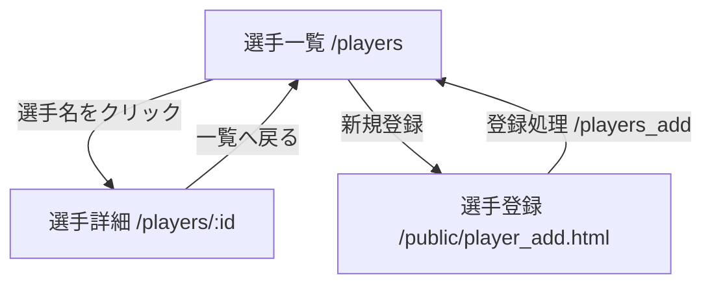

# マンチェスター・ユナイテッド選手情報管理システム

## 1. 開発対象

マンチェスター・ユナイテッドの選手情報をまとめたWebページを作成する．

選手を一覧で表示し，名前をクリックすると背番号やポジション，国籍などの詳しい情報を確認できるようにする．また，新しく選手を登録する機能も追加する．

## 2. ページ構成・ページ遷移

### ページ構成

| ページ | URL | 内容 |
|---|---|---|
| 選手一覧 | /players | 選手の一覧を表示する |
| 選手詳細 | /players/:id | 選手の詳しい情報を表示する |
| 選手登録 | /public/player_add.html | 新しい選手の情報を入力する |
| 登録処理 | /players_add | 入力した選手を追加して一覧に戻る |

### ページ遷移図

## 3. データ構造（スキーマ）

| 項目名 | 型 | 内容 |
|---|---|---|
| id | 数値 | 選手ID |
| name | 文字列 | 選手名 |
| number | 数値 | 背番号 |
| position | 文字列 | ポジション |
| nationality | 文字列 | 国籍 |

選手の情報はJavaScriptの配列にまとめて管理する．
